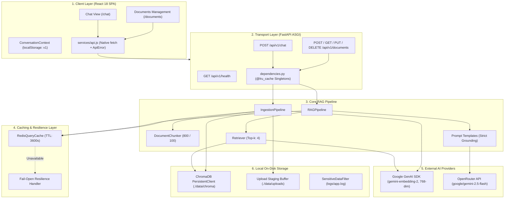
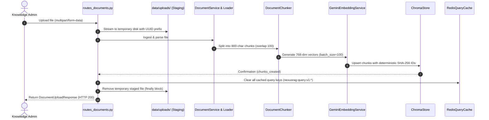
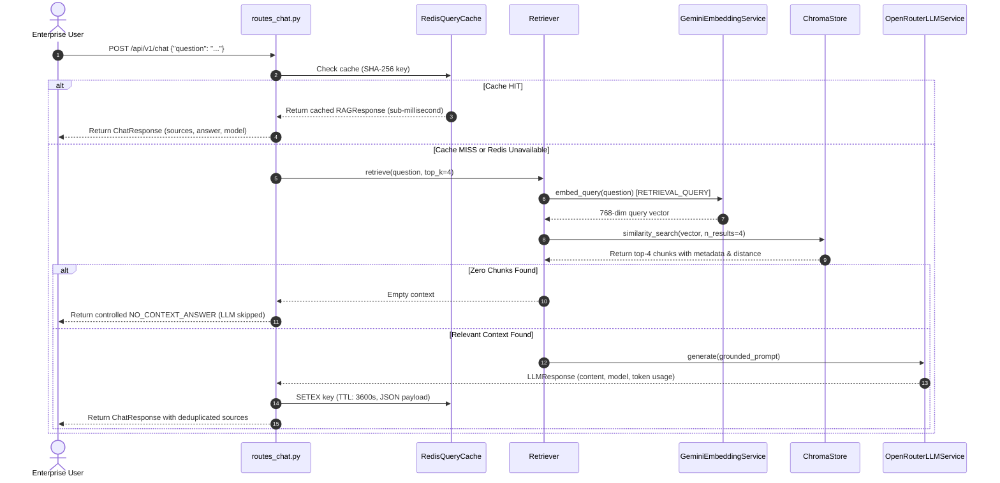

# NexusRAG — Genworx Knowledge Assistant

> **Enterprise-Grade Retrieval-Augmented Generation (RAG) System for Grounded Knowledge Synthesis, Auditable Document Provenance, and High-Throughput Query Caching.**

[](https://fastapi.tiangolo.com)
[](https://www.python.org/)
[](https://react.dev/)
[](https://vitejs.dev/)
[](https://www.trychroma.com/)
[](https://redis.io/)
[-success.svg?style=flat)](NexusRag/backend/tests/)
[](NexusRag/frontend/src/__tests__/)

---

## 1. Project Title & Executive Overview

**NexusRAG (Genworx Knowledge Assistant)** is a full-stack Retrieval-Augmented Generation (RAG) platform engineered to ingest unstructured enterprise documents (`.pdf`, `.txt`, `.md`), chunk and project them into dense vector embeddings, and synthesize accurate, context-grounded answers to natural language user inquiries.

### The Problem It Solves
1. **Parametric Hallucination**: Foundation Large Language Models (LLMs) hallucinate plausible yet factually incorrect assertions when queried about proprietary organizational procedures, internal policies, or niche technical specifications.
2. **Context Window Exhaustion & High Cost**: Stuffing dozens of lengthy organizational runbooks into every LLM prompt exceeds token limits, inflates operational inference costs, and induces attention degradation ("Lost in the Middle").
3. **Absence of Provenance & Auditability**: Standard conversational AI engines cannot substantiate their answers, making them unsuitable for compliance, engineering, and enterprise operations.
4. **Information Stagnation**: Fine-tuning foundation models on updated documentation is cost-prohibitive, introduces multi-day retraining latencies, and risks catastrophic forgetting.

### Core Value Proposition
NexusRAG decouples **external factual knowledge** (stored locally in an on-disk ChromaDB vector store) from **parametric reasoning** (powered by Google Gemini 2.5 Flash via OpenRouter). Answers are strictly grounded in retrieved passages and paired with exact, deduplicated source citations (file name, format, and 1-indexed page numbers). A resilient, fail-open Redis caching layer ensures repeated queries return with sub-millisecond latencies without incurring unnecessary LLM API costs.

> **Deployment Status**: NexusRAG is designed and configured to run locally across developer workstations and internal on-premise environments. No public deployment endpoint is currently maintained.

---

## 2. Key Features (Verified Implementation)

All capabilities documented below are directly backed by verified source code in the repository:

- **Multi-Format Document Ingestion**: Ingests `.pdf`, `.txt`, and `.md` files via streaming `multipart/form-data` uploads. Validates magic bytes, file extensions, and enforces a strict 10 MB per-file size limit with automatic temporary staging cleanup.
- **Hierarchical Text Chunking**: Leverages LangChain's `RecursiveCharacterTextSplitter` configured for 800-character chunks with a 100-character overlap using hierarchical boundaries (`\n\n`, `\n`, space, empty string), preserving paragraph integrity and enriching each chunk with index and count metadata.
- **Asymmetric Vector Embeddings**: Uses Google's `gemini-embedding-2` model producing 768-dimensional dense vectors with task-type differentiation (`RETRIEVAL_DOCUMENT` during indexing, `RETRIEVAL_QUERY` during search) and 100-chunk batching.
- **Persistent Local Vector Store**: Uses ChromaDB `PersistentClient` on local disk (`./data/chroma`). Employs deterministic SHA-256 chunk IDs (`{source}::chunk_{index}`) for idempotent upserts and performs $L^2$ squared distance similarity search.
- **Grounded LLM Synthesis & Strict Guardrails**: Queries Google Gemini 2.5 Flash via the OpenRouter unified gateway. If no relevant chunks are retrieved, the pipeline returns a deterministic fallback message without invoking the LLM, preventing ungrounded hallucinations and wasted tokens.
- **Auditable Citation Provenance**: Every generated response provides a deduplicated array of source references containing document name, file type, and page number, rendered as interactive badge pills in the UI.
- **Fail-Open Distributed Query Caching**: Features a Redis-backed caching layer using normalized SHA-256 query digests (`nexusrag:query:v1:{hash}`) with a 3,600-second (1 hour) TTL. If Redis becomes unavailable, the system fails open gracefully—queries proceed directly to the retrieval pipeline without user-facing errors.
- **Complete Document Management (CRUD)**:
  - **List**: Inspect all indexed documents with canonical names, physical chunk counts, and indexing timestamps.
  - **Delete**: Remove all associated chunk vectors from ChromaDB and automatically invalidate the Redis query cache.
  - **Safe Replacement**: Two-phase replacement that embeds and indexes new files *before* removing stale vectors, preventing data loss if ingestion fails mid-flight.
- **Persistent Multi-Session UI**: A modern React 18 single-page application built with custom Vanilla CSS design tokens (no Tailwind runtime bloat). Features tab-persistent multi-session chat state backed by `localStorage` (`nexusrag:chat-history:v1`), automatic title generation, and live backend health probing.
- **Zero-Network Automated Testing**: 184 backend tests (87% statement coverage) and 52 frontend tests running against deterministic test doubles (`FakeEmbeddingService`, `FakeLLMService`, `FakeRedisClient`).

---

## 3. Visual Architecture & Design Assets

The repository includes high-fidelity SVG architectural diagrams located in [`NexusRag/docs/interview/assets/diagrams/`](NexusRag/docs/interview/assets/diagrams/):

| Master System Architecture | Document Ingestion Pipeline |
| :---: | :---: |
|  |  |
| *End-to-end multi-layer component topology* | *Staging, parsing, chunking, and vector storage* |

| Query & RAG Retrieval Flow | Redis Cache Decision Tree |
| :---: | :---: |
|  |  |
| *Cache check, vector retrieval, and prompt synthesis* | *Normalization, hashing, hit/miss, and fail-open routing* |

*(Maintainers: To add animated UI screencasts or interface screenshots, place assets in `NexusRag/docs/screenshots/` and link them here.)*

---

## 4. Technology Stack

| Layer / Capability | Technology | Version / Spec | Verified Role in NexusRAG |
| :--- | :--- | :--- | :--- |
| **Frontend Framework** | React | `^18.3.1` | Declarative UI rendering, unidirectional data flow, component state lifecycle |
| **Frontend Build Tool** | Vite | `^6.0.1` | ESM development server and Rollup production bundler |
| **Client-Side Routing** | React Router DOM | `^6.28.0` | Client-side routing between `/chat` and `/documents` |
| **Styling Architecture** | Vanilla CSS | Custom Design System | 1,750 lines of scoped design tokens (`--bg-base`, `--primary`), glassmorphism, responsive grid (no Tailwind) |
| **Client Persistence** | Browser `localStorage` | `nexusrag:chat-history:v1` | Multi-conversation history and active session state preservation |
| **Backend Framework** | FastAPI | `>=0.115.0` | High-performance ASGI REST API with auto-generated OpenAPI / Swagger docs |
| **Data Validation** | Pydantic v2 & Settings | `>=2.9.0` / `>=2.5.0` | Strict request/response typing, JSON schemas, and `SecretStr` redaction |
| **ASGI Server** | Uvicorn (Standard) | `>=0.30.0` | ASGI application server with asynchronous networking |
| **RAG Orchestration** | LangChain Core & Community | `>=0.3.0` | Standardized `Document` abstractions and text-splitting tools |
| **Document Parsing** | PyPDF & TextLoader | `pypdf>=5.0.0` | PDF page-level parsing and text/markdown decoding (UTF-8 with Latin-1 fallback) |
| **Text Chunking** | LangChain Text Splitters | `>=0.3.0` | `RecursiveCharacterTextSplitter` (800 char chunk size, 100 char overlap) |
| **Dense Embeddings** | Google Gemini Embedding 2 | `gemini-embedding-2` | 768-dimensional vectors via `google-genai>=2.0.0` with asymmetric task types |
| **Vector Database** | ChromaDB | `>=1.0.0` | Embedded local vector store (`PersistentClient`) with $L^2$ squared distance |
| **LLM Gateway** | OpenRouter | Base URL API | Unified gateway routing to foundation models via OpenAI-compatible schema |
| **Foundation LLM** | Google Gemini 2.5 Flash | `google/gemini-2.5-flash` | Context-grounded response generation via LangChain `ChatOpenAI` |
| **Distributed Cache** | Redis | `redis:7-alpine` | Query result caching with 1-hour TTL via `redis-py>=5.0.0` (Docker container) |
| **Configuration** | PyYAML & python-dotenv | `pyyaml>=6.0.0` | Two-tier config: environment secrets (`.env`) and algorithm params (`config.yaml`) |
| **Backend Testing** | Pytest & Plugins | `pytest>=8.0.0`, `pytest-cov` | Automated unit, integration, and E2E testing (184 tests, 87% coverage) |
| **Frontend Testing** | Vitest & Testing Library | `vitest^2.1.8`, `@testing-library/react` | Component rendering, event simulation, and routing assertions (52 tests) |
| **Infrastructure** | Docker Compose | Spec `3.8` | Container orchestration for supporting Redis infrastructure |

---

## 5. Architecture Overview

NexusRAG employs a modular layered architecture separating presentation, transport, domain orchestration, and persistence:



### Component Responsibilities
1. **Presentation Layer**: React SPA providing conversation view, prompt suggestions, document CRUD table, upload dropzones, and source citation cards.
2. **API & Dependency Layer**: FastAPI application enforcing schema validation (Pydantic), CORS policies, and injecting cached service singletons.
3. **Ingestion Subsystem**: Stages binary uploads, selects the appropriate file loader (`PDFDocumentLoader`, `TextDocumentLoader`, `MarkdownDocumentLoader`), chunks text, generates embeddings, persists vectors to ChromaDB, and clears the Redis query cache.
4. **Retrieval Subsystem**: Encodes incoming user questions with `RETRIEVAL_QUERY` task types, searches ChromaDB using $L^2$ distance, and returns the top-$k$ relevant passages.
5. **Generation Subsystem**: Evaluates context sufficiency. If chunks are present, formats a strictly delimited context prompt and streams requests to OpenRouter.
6. **Distributed Cache**: Stores serialized JSON responses keyed by the SHA-256 hash of the normalized query, model identifier, and retrieval parameters.

---

## 6. End-to-End Request Lifecycle

### Ingestion Lifecycle (`POST /api/v1/documents/upload`)


### Query Lifecycle (`POST /api/v1/chat`)


---

## 7. Repository Structure

```
NexusRag/
├── .env.example                    # Root environment configuration template
├── .gitignore                      # Git exclusion rules (caches, data, logs, secrets)
├── docker-compose.yml              # Redis 7 container orchestration
├── README.md                       # Master repository documentation
│
├── backend/                        # FastAPI Backend Application
│   ├── .env.example                # Backend environment configuration template
│   ├── config.yaml                 # Non-secret RAG & algorithm hyperparameters
│   ├── Dockerfile                  # Container build specification (current placeholder)
│   ├── requirements.txt            # Locked Python runtime and test dependencies
│   ├── app/                        # Application source package
│   │   ├── main.py                 # ASGI entry point, lifespan, CORS, and router registration
│   │   ├── api/                    # HTTP REST transport layer
│   │   │   ├── dependencies.py     # Hierarchical dependency injection singletons
│   │   │   ├── routes_chat.py      # POST /api/v1/chat endpoint
│   │   │   ├── routes_documents.py # POST, GET, PUT, DELETE /api/v1/documents endpoints
│   │   │   └── routes_health.py    # GET /api/v1/health liveness probe
│   │   ├── cache/                  # Caching layer
│   │   │   └── redis_cache.py      # Redis client, SHA-256 key hashing, fail-open logic
│   │   ├── chunking/               # Text partitioning
│   │   │   └── chunker.py          # RecursiveCharacterTextSplitter with metadata enrichment
│   │   ├── core/                   # Application configuration & runtime
│   │   │   ├── config.py           # Pydantic Settings & YAML parameter loader
│   │   │   └── logging.py          # Formatter with regex-based sensitive data redaction
│   │   ├── embeddings/             # Dense vector generation
│   │   │   └── embedder.py         # Google Gemini Embedding 2 (768-dim, asymmetric)
│   │   ├── ingestion/              # Document loading & staging
│   │   │   ├── document_service.py # Ingestion coordination & file validation
│   │   │   ├── loader.py           # PyPDF, Text, and Markdown format loaders
│   │   │   └── pipeline.py         # End-to-end ingestion orchestrator
│   │   ├── llm/                    # Language model integration
│   │   │   ├── llm_service.py      # Base LLM abstractions and exception hierarchy
│   │   │   └── openrouter.py       # OpenRouter gateway client via LangChain ChatOpenAI
│   │   ├── models/                 # Transport schemas
│   │   │   ├── requests.py         # Pydantic request models (ChatRequest)
│   │   │   └── responses.py        # Pydantic response models (ChatResponse, DocumentListResponse)
│   │   ├── prompts/                # Prompt engineering
│   │   │   └── templates.py        # Strict anti-hallucination prompt templates
│   │   ├── rag/                    # Pipeline orchestration
│   │   │   └── pipeline.py         # Query execution, cache checks, and citation extraction
│   │   ├── retrieval/              # Semantic search
│   │   │   └── retriever.py        # Dense similarity search coordinator
│   │   ├── utils/                  # Helper utilities (helpers.py)
│   │   └── vectordb/               # Vector storage layer
│   │       └── chroma_store.py     # ChromaDB PersistentClient wrapper & canonicalization
│   └── tests/                      # Automated backend test suite (184 test cases)
│       ├── conftest.py             # Deterministic test fixtures and doubles
│       ├── test_cache.py           # Redis caching & fail-open tests
│       ├── test_chat.py            # Chat API endpoint tests
│       ├── test_chunking.py        # Recursive chunking & overlap tests
│       ├── test_config.py          # Settings, YAML parsing, & secret guard tests
│       ├── test_documents.py       # Ingestion & upload validation tests
│       ├── test_documents_crud.py  # List, delete, and safe replacement tests
│       ├── test_e2e_integration.py # Full RAG pipeline integration tests
│       ├── test_embeddings.py      # Gemini embedding service tests
│       ├── test_health.py          # Health check endpoint tests
│       ├── test_ingestion.py       # Document loader tests
│       ├── test_llm.py             # OpenRouter client & error translation tests
│       ├── test_logging.py         # Sensitive data redaction tests
│       ├── test_rag.py             # RAG pipeline logic tests
│       ├── test_retrieval.py       # Dense vector retrieval tests
│       └── test_vectordb.py        # ChromaDB operations & canonicalization tests
│
├── frontend/                       # React 18 SPA Frontend
│   ├── .env.example                # Frontend environment configuration template
│   ├── index.html                  # HTML5 document template
│   ├── package.json                # npm package manifest & scripts
│   ├── vite.config.js              # Vite configuration & Vitest setup
│   ├── src/                        # Frontend source code
│   │   ├── App.jsx                 # Main application shell & routing
│   │   ├── main.jsx                # DOM mount entry point
│   │   ├── setupTests.js           # Testing library setup
│   │   ├── components/             # Reusable UI components
│   │   │   ├── ChatInput.jsx       # Chat input textarea with character counter
│   │   │   ├── ChatMessage.jsx     # User & assistant chat bubbles
│   │   │   ├── ChatWindow.jsx      # Conversation stream & suggestion chips
│   │   │   ├── DeleteConfirmModal.jsx # Destructive action confirmation modal
│   │   │   ├── DocumentList.jsx    # Document management table with search filter
│   │   │   ├── DocumentRow.jsx     # Individual document row with actions
│   │   │   ├── DocumentUploader.jsx # Drag-and-drop document upload panel
│   │   │   ├── EmptyDocumentState.jsx # Empty state UI for documents page
│   │   │   ├── LoadingIndicator.jsx # Loading spinners & skeleton states
│   │   │   ├── Navbar.jsx          # Header with branding, navigation, & health dot
│   │   │   ├── ReplaceDocumentModal.jsx # Two-phase file replacement modal
│   │   │   └── SourceCard.jsx      # Grounded source citation badge pill
│   │   ├── context/                # React state context
│   │   │   └── ConversationContext.jsx # Multi-session chat history with localStorage
│   │   ├── hooks/                  # Custom React hooks
│   │   │   ├── useChat.js          # Chat state and message submission hook
│   │   │   └── useDocuments.js     # Document list and CRUD operations hook
│   │   ├── pages/                  # Route views
│   │   │   ├── ChatPage.jsx        # Conversation view
│   │   │   └── DocumentsPage.jsx   # Document management view
│   │   ├── services/               # API transport
│   │   │   └── api.js              # Centralized fetch client & error normalizer
│   │   ├── styles/                 # Styling architecture
│   │   │   └── index.css           # Vanilla CSS Enterprise Design System (1,750 lines)
│   │   ├── utils/                  # Utility functions
│   │   │   └── helpers.js          # File size, date, and text formatting helpers
│   │   └── __tests__/              # Automated frontend test suite (52 test cases)
│   │       ├── chat.test.jsx       # Chat UI and interaction tests
│   │       ├── conversations.test.jsx # Session persistence and title tests
│   │       ├── documents_crud.test.jsx # Document management table & modal tests
│   │       ├── routing.test.jsx    # React Router navigation tests
│   │       └── upload.test.jsx     # File upload dropzone tests
│
├── docs/                           # Documentation
│   ├── interview/                  # Technical design guide & SVG diagrams
│   └── phases/                     # 15 Phase development specifications
│
└── evaluation/                     # RAG Evaluation Framework (Future Roadmap)
    ├── dataset.json                # Benchmark QA dataset (current scaffold)
    ├── evaluate_answers.py         # Faithfulness & relevance evaluation script (current scaffold)
    └── evaluate_retrieval.py       # Hit rate & MRR evaluation script (current scaffold)
```

---

## 8. Prerequisites

Ensure your host environment meets the following specifications before installing dependencies:

| Runtime / Service | Required Version | Verified Version | Verification Command |
| :--- | :--- | :--- | :--- |
| **Python** | `>= 3.10` (Recommended `3.11+`) | `3.11.0` | `python --version` |
| **Node.js** | `>= 18.0.0` | `v24.21.0` | `node --version` |
| **npm** | `>= 9.0.0` | `11.19.0` | `npm --version` |
| **Docker & Compose** | `>= 20.10` / Compose `v2+` | Installed locally | `docker compose version` |
| **Google Gemini API Key** | Valid API Secret | Active | [Google AI Studio](https://aistudio.google.com/) |
| **OpenRouter API Key** | Valid API Secret | Active | [OpenRouter Console](https://openrouter.ai/) |

---

## 9. Environment Configuration

### Backend Configuration (`NexusRag/backend/.env`)

Create `NexusRag/backend/.env` by copying `NexusRag/backend/.env.example`:

| Environment Variable | Purpose | Required? | Default / Example Value |
| :--- | :--- | :---: | :--- |
| `PROJECT_NAME` | Application display name | No | `NexusRAG` |
| `APP_NAME` | Alias for `PROJECT_NAME` | No | `NexusRAG` |
| `VERSION` | API version string | No | `0.1.0` |
| `API_V1_STR` | API route prefix | No | `/api/v1` |
| `ENVIRONMENT` | Deployment environment label | No | `development` |
| `DEBUG` | Enable Uvicorn auto-reload | No | `False` |
| `LOG_LEVEL` | Console and file logging verbosity | No | `INFO` |
| `HOST` | ASGI server bind address | No | `0.0.0.0` |
| `PORT` | ASGI server listening port | No | `8000` |
| `LLM_PROVIDER` | Foundation LLM gateway selector | No | `openrouter` |
| `LLM_MODEL` | Foundation LLM model identifier | No | `google/gemini-2.5-flash` |
| `GEMINI_API_KEY` | Google GenAI API key for embeddings | **Yes** | `AIzaSy...` (from Google AI Studio) |
| `OPENROUTER_API_KEY` | OpenRouter API key for LLM generation | **Yes** | `sk-or-v1-...` (from OpenRouter) |
| `CHROMA_PATH` | Local on-disk vector store path | No | `./data/chroma` |
| `CHROMA_PERSIST_DIRECTORY` | Alias for `CHROMA_PATH` | No | `./data/chroma` |
| `REDIS_URL` | Redis connection connection string | No | `redis://localhost:6379/0` |

> [!SECURITY]
> API keys must **only** be placed in `.env`. The `config.yaml` parser contains a strict security guard that throws an immediate `ValueError` if keys containing `api_key`, `secret`, `password`, or `token` are committed to `config.yaml`.

### Frontend Configuration (`NexusRag/frontend/.env`)

Create `NexusRag/frontend/.env` by copying `NexusRag/frontend/.env.example`:

| Environment Variable | Purpose | Required? | Default / Example Value |
| :--- | :--- | :---: | :--- |
| `VITE_API_BASE_URL` | Backend FastAPI endpoint base URL | **Yes** | `http://localhost:8000/api/v1` |

---

## 10. Installation & Local Setup

### Step 1: Clone the Repository
```bash
git clone https://github.com/<your-username>/NexusRAG.git
cd NexusRAG/NexusRag
```

### Step 2: Start Redis Infrastructure
Launch the local Redis container using Docker Compose from the `NexusRag` directory:
```bash
docker compose up -d redis
```
Verify Redis is running and responsive:
```bash
docker compose ps
docker exec -it nexusrag-redis redis-cli ping
# Expected output: PONG
```

### Step 3: Configure and Install the Backend

#### Windows (PowerShell)
```powershell
# Navigate to the backend directory
cd backend

# Create and activate a Python virtual environment
python -m venv .venv
.\.venv\Scripts\Activate.ps1

# Upgrade pip and install runtime dependencies
python -m pip install --upgrade pip
pip install -r requirements.txt

# Create environment configuration
Copy-Item .env.example .env
# Edit .env and supply GEMINI_API_KEY and OPENROUTER_API_KEY
```

#### Linux / macOS (Bash)
```bash
# Navigate to the backend directory
cd backend

# Create and activate a Python virtual environment
python3 -m venv .venv
source .venv/bin/activate

# Upgrade pip and install runtime dependencies
python -m pip install --upgrade pip
pip install -r requirements.txt

# Create environment configuration
cp .env.example .env
# Edit .env and supply GEMINI_API_KEY and OPENROUTER_API_KEY
```

### Step 4: Configure and Install the Frontend
```bash
# Navigate to the frontend directory
cd ../frontend

# Install dependencies via npm
npm install

# Create environment configuration
cp .env.example .env
# Verify VITE_API_BASE_URL=http://localhost:8000/api/v1
```

---

## 11. Running the Application

To run the complete system locally, maintain three active terminal sessions:

### Terminal 1: Supporting Infrastructure (Redis)
```bash
cd NexusRag
docker compose up redis
```

### Terminal 2: FastAPI Backend Server
```bash
cd NexusRag/backend

# Activate virtual environment (Windows PowerShell)
.\.venv\Scripts\Activate.ps1
# On Linux/macOS: source .venv/bin/activate

# Start the ASGI server
python -m app.main
# Alternative: uvicorn app.main:app --host 0.0.0.0 --port 8000 --reload
```
*Expected log output:*
```
INFO | app.core.logging:setup_logging:117 - Logging initialized at level INFO
INFO | app.main:lifespan:19 - Starting NexusRAG (v0.1.0) in [development] environment
INFO:     Uvicorn running on http://0.0.0.0:8000 (Press CTRL+C to quit)
```

### Terminal 3: React Vite Frontend Dev Server
```bash
cd NexusRag/frontend
npm run dev
```
*Expected output:*
```
  VITE v6.0.1  ready in 240 ms

  ➜  Local:   http://localhost:5173/
  ➜  Network: http://<your-lan-ip>:5173/
```

### Local Endpoint Directory

| Interface | Local URL | Description |
| :--- | :--- | :--- |
| **Frontend Web Application** | [http://localhost:5173](http://localhost:5173) | Main user interface (Chat and Documents views) |
| **FastAPI Interactive Docs (Swagger)** | [http://localhost:8000/api/v1/docs](http://localhost:8000/api/v1/docs) | Interactive OpenAPI exploration and testing |
| **FastAPI Alternative Docs (ReDoc)** | [http://localhost:8000/api/v1/redoc](http://localhost:8000/api/v1/redoc) | Clean technical API schema documentation |
| **Backend Health Check** | [http://localhost:8000/api/v1/health](http://localhost:8000/api/v1/health) | JSON liveness probe |

---

## 12. Troubleshooting Common Setup Issues

| Symptom | Root Cause | Solution |
| :--- | :--- | :--- |
| **Navbar displays "Offline"** | Frontend cannot reach backend at `VITE_API_BASE_URL`. | Ensure the backend is running on port 8000. Verify `frontend/.env` contains `http://localhost:8000/api/v1` (not a stale LAN IP). |
| **502 Bad Gateway on `/api/v1/chat`** | `OPENROUTER_API_KEY` is missing, invalid, or exhausted. | Check `backend/.env`. Ensure you have an active key from [OpenRouter](https://openrouter.ai/) with positive credit. |
| **500 Error during Document Upload** | `GEMINI_API_KEY` is missing or invalid. | Check `backend/.env`. Ensure you have an active Google AI Studio API key for `gemini-embedding-2`. |
| **Redis Connection Error logged** | Redis container is not running on `localhost:6379`. | Run `docker compose up -d redis`. Note that NexusRAG **fails open**; queries will still execute, though un-cached. |
| **CORS blocked by browser** | Frontend origin not in `CORS_ORIGINS`. | Default CORS origins allow `http://localhost:3000` and `http://localhost:5173`. If using custom hosts, update `CORS_ORIGINS` in `app/core/config.py`. |
| **File rejected with 413 error** | Uploaded file exceeds 10 MB limit. | Split the file or adjust `max_file_size_mb` in `backend/config.yaml`. |

---

## 13. REST API Reference

All routes are mounted under the `/api/v1` prefix.

| Method | Endpoint | Summary | Request Body | Response Model | Status Codes |
| :--- | :--- | :--- | :--- | :--- | :--- |
| `GET` | `/health` | Application liveness probe | None | `HealthResponse` | `200` |
| `POST` | `/chat` | Submit question to RAG pipeline | `ChatRequest` (JSON) | `ChatResponse` | `200`, `422`, `500`, `502` |
| `POST` | `/documents/upload` | Ingest and index new document | `multipart/form-data` | `DocumentUploadResponse` | `200`, `400`, `413`, `422`, `500` |
| `GET` | `/documents` | List all indexed documents | None | `DocumentListResponse` | `200`, `500` |
| `PUT` | `/documents/{source}` | Safe document replacement | `multipart/form-data` | `DocumentUploadResponse` | `200`, `400`, `404`, `413`, `422`, `500` |
| `DELETE` | `/documents/{source}` | Delete document and vectors | None | `DocumentDeleteResponse` | `200`, `404`, `500` |

### Detailed Payload Examples

#### 1. Submit Chat Query (`POST /api/v1/chat`)

*Request:*
```json
{
  "question": "What is the company annual leave policy and how is it requested?"
}
```

*Response (`200 OK`):*
```json
{
  "answer": "Employees receive 20 days of paid annual leave per calendar year. Leave must be requested through the internal HR portal at least two weeks in advance and requires manager approval.",
  "sources": [
    {
      "source": "Employee_Handbook_2026.pdf",
      "file_type": "pdf",
      "page": 14
    }
  ],
  "query": "What is the company annual leave policy and how is it requested?",
  "model": "google/gemini-2.5-flash",
  "context_chunks_used": 2
}
```

#### 2. Ingest Document (`POST /api/v1/documents/upload`)

*Request:* Form-data with file payload under the `file` field (`policy.pdf`).

*Response (`200 OK`):*
```json
{
  "filename": "policy.pdf",
  "file_type": "pdf",
  "file_size_bytes": 1048576,
  "chunks_created": 18,
  "status": "success",
  "message": "Successfully indexed 'policy.pdf' (18 chunks created)"
}
```

#### 3. List Documents (`GET /api/v1/documents`)

*Response (`200 OK`):*
```json
{
  "documents": [
    {
      "source": "Employee_Handbook_2026.pdf",
      "file_type": "pdf",
      "chunk_count": 42,
      "indexed_at": "2026-10-15T09:30:00Z"
    },
    {
      "source": "Architecture_Spec.md",
      "file_type": "md",
      "chunk_count": 15,
      "indexed_at": "2026-10-18T14:22:10Z"
    }
  ],
  "total_chunks": 57
}
```

---

## 14. Testing & Quality Assurance

NexusRAG uses automated testing suites across both the backend and frontend. Tests are designed for deterministic, isolated, zero-network execution using comprehensive test doubles.

### Verified Test Results

```
==================================================================================
BACKEND TEST SUITE (pytest 9.1.1, Python 3.11.0, pytest-cov 7.1.0)
==================================================================================
Total Backend Tests Executed : 184
Passed                       : 184 (100%)
Failed                       : 0
Execution Duration           : 13.30 seconds
Total Statements Evaluated   : 1,741
Overall Statement Coverage   : 87%

Key Module Coverage Breakdown:
- app/chunking/chunker.py        : 100%
- app/api/routes_health.py       : 100%
- app/models/responses.py        : 100%
- app/ingestion/pipeline.py      : 98%
- app/retrieval/retriever.py     : 98%
- app/llm/llm_service.py         : 96%
- app/prompts/templates.py       : 96%
- app/rag/pipeline.py            : 94%
- app/api/dependencies.py        : 94%
- app/embeddings/embedder.py     : 91%
- app/core/config.py             : 90%
- app/ingestion/document_service : 90%
- app/ingestion/loader.py        : 85%
- app/api/routes_chat.py         : 85%
- app/llm/openrouter.py          : 82%
- app/api/routes_documents.py    : 80%
- app/vectordb/chroma_store.py   : 79%
- app/cache/redis_cache.py       : 79%
- app/core/logging.py            : 77%

==================================================================================
FRONTEND TEST SUITE (Vitest 2.1.9, JSDOM, React Testing Library)
==================================================================================
Total Test Files Evaluated   : 5
Total Frontend Tests Executed: 52
Passed                       : 52 (100%)
Failed                       : 0
Execution Duration           : 25.13 seconds

Test Files:
✓ src/__tests__/upload.test.jsx          (6 tests)
✓ src/__tests__/documents_crud.test.jsx  (12 tests)
✓ src/__tests__/routing.test.jsx         (4 tests)
✓ src/__tests__/chat.test.jsx            (11 tests)
✓ src/__tests__/conversations.test.jsx   (19 tests)
==================================================================================
```

### Running Backend Tests & Coverage

```bash
cd NexusRag/backend

# Activate virtual environment
# Windows: .\.venv\Scripts\Activate.ps1
# Linux/macOS: source .venv/bin/activate

# Run all backend tests
pytest tests -v

# Run backend tests with coverage report
pytest tests --cov=app --cov-report=term-missing
```

### Running Frontend Tests & Production Build

```bash
cd NexusRag/frontend

# Run Vitest test suite once
npm test

# Verify Vite production build
npm run build
```

### Testing Strategy & Zero-Network Mocks
- **`FakeEmbeddingService`**: Concept-mapped semantic projection that computes 768-dimensional unit vectors without making external Google API calls.
- **`FakeLLMService`**: Deterministic prompt-tracking double returning canned responses and simulated token metrics.
- **`FakeRedisClient`**: In-memory dictionary-backed Redis client simulating connection drops, key TTLs, and cache hits/misses.
- **Temporary ChromaDB**: Tests instantiate isolated `ChromaStore` instances against `pytest`'s `tmp_path` fixture, guaranteeing zero disk pollution across runs.

---

## 15. Architectural Decisions & Engineering Trade-Offs

### Decision 1: ChromaDB Embedded (`PersistentClient`) vs. Distributed Vector DB
- **Context**: The application requires low-latency vector storage and similarity retrieval for small-to-medium enterprise document collections.
- **Decision**: Embedded ChromaDB using `PersistentClient` saving to local disk (`./data/chroma`).
- **Benefit**: Zero external infrastructure overhead (no separate database container, network hops, or connection pools to maintain).
- **Trade-Off**: SQLite file locking prevents concurrent multi-process horizontal writes. For large-scale distributed deployments, transitioning to Chroma Client-Server mode or pgvector is required.

### Decision 2: Asymmetric Embeddings (`gemini-embedding-2`) vs. Generic Embeddings
- **Context**: Document chunks represent informative context, while user queries represent concise, intent-driven questions.
- **Decision**: Google's `gemini-embedding-2` using explicit task types (`RETRIEVAL_DOCUMENT` for chunks, `RETRIEVAL_QUERY` for search prompts).
- **Benefit**: Significantly improves Mean Reciprocal Rank (MRR) by optimizing vector projections for asymmetric information retrieval.
- **Trade-Off**: Introduces an external network dependency during ingestion and search.

### Decision 3: Fail-Open Redis Query Caching with Normalized SHA-256 Hashing
- **Context**: LLM inference costs and latency must be minimized for repeated organizational questions, but cache failures should never break user search.
- **Decision**: Query caching in Redis with normalized SHA-256 keys (`strip -> lowercase -> collapse whitespace`). All Redis calls are wrapped in fail-open handlers.
- **Benefit**: Cache hits resolve in `< 5ms` with zero token cost. If Redis crashes or network drops, queries transparently bypass the cache and execute normal RAG.
- **Trade-Off**: Memory footprint in Redis scales with unique query volume (mitigated by 1-hour TTL and automated invalidation on document CRUD).

### Decision 4: Two-Phase Safe Document Replacement
- **Context**: Updating an existing document could lead to knowledge base corruption if parsing, chunking, or embedding fails halfway through.
- **Decision**: Two-phase replacement: new document chunks are parsed, embedded, and indexed into ChromaDB *first*. Only after new chunks are safely written are previous vectors unlinked and deleted.
- **Benefit**: Zero downtime or data loss; if an invalid replacement file is uploaded, the existing document vectors remain completely intact.
- **Trade-Off**: Temporarily doubles vector storage consumption during the brief window of the replacement operation.

### Decision 5: Non-Tailwind Vanilla CSS Design System
- **Context**: Enterprise UI styling requires high polish, quick loading, and consistent branding.
- **Decision**: Custom CSS design system using native CSS variables (`--bg-base`, `--primary`, `--radius-lg`) rather than utility classes.
- **Benefit**: Zero build-step CSS dependencies, pristine HTML readability, and fine-grained control over typography and animations.
- **Trade-Off**: Requires writing modular CSS classes rather than inline rapid-prototyping utility classes.

---

## 16. Security Considerations

### Implemented Controls
- **Secret Redaction in Memory**: API keys are parsed into Pydantic `SecretStr` instances, preventing accidental serialization or display in error traces.
- **Regex-Based Log Redaction**: `SensitiveDataFilter` scrubs Google API keys (`AIzaSy...`), OpenAI/OpenRouter keys (`sk-...`), and Bearer tokens from console and `logs/app.log`.
- **Secret Guard in Configuration**: `_load_yaml_config()` inspects `config.yaml` on startup and aborts execution if API keys or passwords are found in plaintext YAML files.
- **Upload Validation & Path Traversal Defense**: File names are sanitized (`Path.name`), staging uses random UUID prefixes, extensions are checked against an allowlist, and 0-byte or oversized files (>10 MB) are rejected before chunking.
- **No Insecure Deserialization**: Redis cache payloads are serialized strictly as UTF-8 JSON; Python `pickle` is deliberately avoided to eliminate arbitrary code execution vulnerabilities (CWE-502).

### Production Roadmap & Future Hardening
- **Authentication & RBAC**: The current API does not require user authentication (designed for trusted internal developer networks). Production deployment requires JWT/OAuth2 authentication and role-based access control.
- **Network Isolation**: Move ChromaDB and Redis into private VPC subnets with mutual TLS (mTLS).
- **Rate Limiting**: Enforce per-user token-bucket rate limits on `/api/v1/chat` to protect against denial-of-wallet attacks.

---

## 17. Known Limitations & Planned Enhancements

| Area | Current State (Verified) | Planned Enhancement |
| :--- | :--- | :--- |
| **Backend Containerization** | `backend/Dockerfile` is currently empty (0 bytes). Redis is containerized via `docker-compose.yml`. | Supply multi-stage production Dockerfile for backend service. |
| **Evaluation Suite** | `evaluation/` directory contains empty scaffold files (`dataset.json`, `evaluate_answers.py`, `evaluate_retrieval.py`). | Implement automated Ragas or TruLens evaluation pipelines measuring Faithfulness, Answer Relevance, and Context Precision. |
| **Multi-Tenancy** | Single shared ChromaDB collection (`nexusrag_documents`) for all users. | Implement multi-tenant tenant isolation via ChromaDB metadata filtering or per-tenant collections. |
| **Document Formats** | Supports `.pdf`, `.txt`, `.md`. Scanned image PDFs without text layers are rejected (no OCR). | Integrate Tesseract OCR or unstructured.io for scanned document and table parsing. |
| **Model Streaming** | `/api/v1/chat` returns a complete JSON response after generation completes. | Implement Server-Sent Events (SSE) streaming for token-by-token output in the UI. |

---

## 18. Contributing

Contributions are welcome! Please follow this workflow to submit changes:

1. **Fork and Branch**: Create a feature branch off `main`:
   ```bash
   git checkout -b feature/your-feature-name
   ```
2. **Implement & Test**: Add code with corresponding tests in `backend/tests/` or `frontend/src/__tests__/`.
3. **Validate Quality Gates**: Ensure all tests and builds pass cleanly:
   ```bash
   # Backend checks
   pytest backend/tests --cov=backend/app
   
   # Frontend checks
   cd frontend
   npm test
   npm run build
   ```
4. **Submit PR**: Open a Pull Request against `main` describing your architectural changes, problem context, and verified test results.

---

## 19. License & Acknowledgments

### License
No formal open-source license file is currently present in the repository. All rights are reserved by the original project authors. Consult the repository maintainers before redistributing or using this software commercially.

### Acknowledgments
- **[FastAPI](https://fastapi.tiangolo.com/)** & **[Uvicorn](https://www.uvicorn.org/)** for the asynchronous Python backend runtime.
- **[LangChain](https://www.langchain.com/)** for document loaders and text splitting utilities.
- **[ChromaDB](https://www.trychroma.com/)** for local persistent vector storage.
- **[Google GenAI](https://ai.google.dev/)** for state-of-the-art dense embeddings (`gemini-embedding-2`).
- **[OpenRouter](https://openrouter.ai/)** for model gateway routing to Google Gemini 2.5 Flash.
- **[Redis](https://redis.io/)** for distributed high-speed query result caching.
- **[React](https://react.dev/)** & **[Vite](https://vitejs.dev/)** for the user interface.

---

## 20. Quick-Start Checklist

Use this compact checklist to verify your local setup:

```
[ ] 1. Clone repository and navigate to NexusRag directory
[ ] 2. Start Redis: docker compose up -d redis
[ ] 3. Backend: cd backend && python -m venv .venv && source/activate venv
[ ] 4. Backend: pip install -r requirements.txt
[ ] 5. Backend: copy .env.example to .env and insert GEMINI_API_KEY & OPENROUTER_API_KEY
[ ] 6. Backend: python -m app.main (running on http://localhost:8000)
[ ] 7. Frontend: cd ../frontend && npm install
[ ] 8. Frontend: copy .env.example to .env (verify VITE_API_BASE_URL=http://localhost:8000/api/v1)
[ ] 9. Frontend: npm run dev (access at http://localhost:5173)
[ ] 10. Run tests: pytest backend/tests (184 passed) && cd frontend && npm test (52 passed)
```

