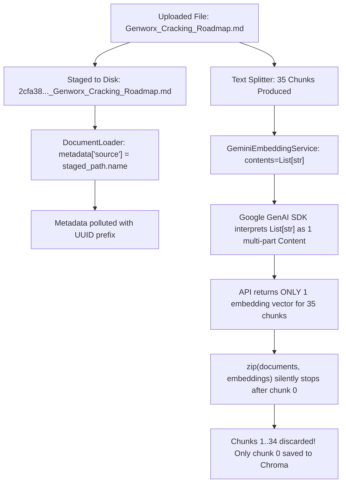

# Phase 15 — Document Listing Data Correctness & Embedding Batch Fix

## 1. Executive Summary

During validation of Phase 14's enterprise light redesign, two critical data correctness defects were identified in the **Documents** management page:
1. **Source / Filename Appearing as a UUID Hash**: The document list displayed `2cfa38edf3294abf9292...` instead of the canonical uploaded filename `Genworx_Cracking_Roadmap.md`.
2. **Chunk Count Discrepancy (1 Chunk vs 35 Chunks)**: While the upload modal reported 35 chunks created upon ingestion, the table row displayed `1 chunk`, and the page header reported `1 document • 1 total chunks`.

This phase executes a rigorous root-cause analysis, corrects the ingestion and embedding architecture, adheres strictly to **physical ChromaDB vector records as the single source of truth**, ensures backward compatibility with legacy development data, and adds deterministic automated tests across the backend and frontend suites.

---

## 2. Problem Statement & Forensic Investigation

### 2.1 Observed Symptoms

When uploading `Genworx_Cracking_Roadmap.md` (35 chunks) in the UI:
- **Upload Toast / Modal**: Reported `"Successfully ingested and indexed 'Genworx_Cracking_Roadmap.md' (35 chunks)"`.
- **Document List Table**:
  - `DOCUMENT`: `2cfa38edf3294abf9292...`
  - `TYPE`: `MD`
  - `CHUNKS`: `1 chunk`
- **Table Header**: `1 document • 1 total chunks`.

### 2.2 Forensic Inspection of Live ChromaDB Data

A diagnostic script was executed against the active local ChromaDB persist directory (`backend/data/chroma`) to inspect actual collection records:

```python
collection = client.get_collection("nexusrag_knowledge_base")
records = collection.get(include=["documents", "metadatas"])
```

#### Actual Data Observed:
- **Total Physical Records**: Exactly **1** record existed (`ids: ['f8c7255c98395bbd']`).
- **Record Metadata**:
  ```json
  {
    "char_count": 894,
    "chunk_count": 35,
    "chunk_index": 0,
    "file_name": "2cfa38edf3294abf9292b2bda6f77155_Genworx_Cracking_Roadmap.md",
    "file_path": "D:\\Academic-Projects\\RAG\\NexusRag\\backend\\data\\uploads\\2cfa38edf3294abf9292b2bda6f77155_Genworx_Cracking_Roadmap.md",
    "file_size_bytes": 36142,
    "file_type": "md",
    "indexed_at": "2026-09-06T20:08:17Z",
    "source": "2cfa38edf3294abf9292b2bda6f77155_Genworx_Cracking_Roadmap.md"
  }
  ```

This inspection proved:
1. The metadata `source` and `file_name` were polluted with the staging disk filename.
2. The metadata recorded `chunk_count: 35` and `chunk_index: 0`.
3. **Only 1 chunk vector was physically stored in ChromaDB.** Chunks 1 through 34 were completely absent from the vector database.

---

## 3. Root Cause Analysis



### 3.1 Defect 1: Staging UUID Disk Name Leakage
- **Origin**: `backend/app/api/routes_documents.py` line 88 generates `staging_filename = f"{uuid.uuid4().hex}_{sanitized_filename}"` to guarantee collision-free staging in `data/uploads/`.
- **Bug**: `routes_documents.py` passed `staged_path` directly to `ingestion_pipeline.index_file(staged_path)`.
- **Propagation**: `DocumentLoader` in `backend/app/ingestion/loader.py` extracted `metadata["source"] = file_path.name` and `metadata["file_name"] = file_path.name`.
- **Result**: The temporary staging name (`2cfa38..._Genworx_Cracking_Roadmap.md`) was persisted into ChromaDB metadata as the permanent source name.

### 3.2 Defect 2: Gemini Batch Embedding SDK Packaging & Silent Drop
- **Origin**: In `backend/app/embeddings/embedder.py`, `embed_texts()` called:
  ```python
  response = client.models.embed_content(
      model=self.model,
      contents=clean_batch,  # clean_batch was List[str]
      config=config,
  )
  ```
- **SDK Protocol Bug**: In the `google-genai` SDK, passing `contents=["chunk 0", "chunk 1", ...]` does **not** treat each string as a separate embedding target. Instead, it treats the list as multiple *Parts* of a **single `Content` object**, returning **only 1 embedding vector** for the entire batch.
- **Silent Truncation**: In `embed_documents()`:
  ```python
  texts = [doc.page_content for doc in documents]
  embeddings = self.embed_texts(texts)
  embedded_chunks = []
  for doc, vector in zip(documents, embeddings):
      embedded_chunks.append(...)
  ```
  Because `len(documents) == 35` but `len(embeddings) == 1`, Python's `zip()` function silently terminated after 1 iteration. Chunks 1 through 34 were discarded without logging or error.
- **Result**: Only chunk 0 was upserted into ChromaDB.

### 3.3 Source of Truth Discipline
Even though chunk 0 metadata contained `chunk_count: 35`, ChromaDB physically contained only 1 record. A naive fix might have read metadata `chunk_count: 35` to display in the UI. However, **physical Chroma records are the single source of truth**. Fabricating counts from metadata would mask incomplete indexing and mislead users into thinking 35 vectors were searchable when only 1 was indexed.

---

## 4. Architectural & Code Modifications

### 4.1 Original Filename Propagation
The canonical filename is now preserved end-to-end through the ingestion pipeline:

```
UploadFile (sanitized)
    ↓
routes_documents.py (passes original_filename=sanitized_filename)
    ↓
IngestionPipeline.index_file(staged_path, original_filename=sanitized_filename)
    ↓
DocumentService.ingest_file(staged_path, original_filename=original_filename)
    ↓
doc.metadata["source"] = original_filename
doc.metadata["file_name"] = original_filename
    ↓
ChromaDB (stores clean canonical filename)
```

- **[backend/app/ingestion/document_service.py](file:///d:/Academic-Projects/RAG/NexusRag/backend/app/ingestion/document_service.py)**:
  Added `original_filename: Optional[str] = None` to `ingest_file()`. When provided, explicitly overrides `doc.metadata["source"]` and `doc.metadata["file_name"]`.
- **[backend/app/ingestion/pipeline.py](file:///d:/Academic-Projects/RAG/NexusRag/backend/app/ingestion/pipeline.py)**:
  Added `original_filename: Optional[str] = None` to `index_file()`. Included backward-compatible fallback for legacy test mocks that accept only `file_path`.
- **[backend/app/api/routes_documents.py](file:///d:/Academic-Projects/RAG/NexusRag/backend/app/api/routes_documents.py)**:
  Passed `sanitized_filename` as `original_filename` in `upload_document` and `replace_document`.

### 4.2 Multi-Text Batch Embedding Packaging & Invariant Guard
In **[backend/app/embeddings/embedder.py](file:///d:/Academic-Projects/RAG/NexusRag/backend/app/embeddings/embedder.py)**:
1. Multi-text inputs are now converted into individual `types.Content` objects:
   ```python
   if isinstance(contents, (list, tuple)):
       api_contents = [
           types.Content(parts=[types.Part.from_text(text=str(t))])
           if isinstance(t, str) else t
           for t in contents
       ]
   else:
       api_contents = contents
   ```
   This ensures Google GenAI generates exactly 1 embedding vector per input text.
2. Added an explicit invariant guard in `embed_documents()`:
   ```python
   if len(embeddings) != len(documents):
       raise EmbeddingProviderError(
           f"Embedding count mismatch: expected {len(documents)} vectors for "
           f"{len(documents)} document chunks, but received {len(embeddings)} from embedding provider."
       )
   ```
   If the embedding provider ever returns fewer embeddings than documents, the system fails loudly rather than silently dropping chunks.

### 4.3 ChromaStore Canonicalization & Physical Record Truth
In **[backend/app/vectordb/chroma_store.py](file:///d:/Academic-Projects/RAG/NexusRag/backend/app/vectordb/chroma_store.py)**:
1. **`_canonicalize_source(source: Optional[str]) -> str`**:
   Strips legacy `^[0-9a-fA-F]{32}_(.+)$` staging prefixes from earlier development records, returning the original filename. If missing, reports `"Unknown Document"`.
2. **`_normalize_file_type(file_type: Optional[str], canonical_source: str) -> str`**:
   Normalizes extensions (e.g. `'md'` or `'.md'` -> `'.md'`).
3. **`list_sources() -> List[Dict[str, Any]]`**:
   Scans collection metadata, groups by `canonical_source`, and counts **actual physical Chroma records**:
   ```python
   source_map[canonical_source]["chunk_count"] += 1
   ```
   Physical records are the sole source of truth.
4. **`get_chunk_ids_by_source(source: str) -> List[str]`**:
   Finds all chunk IDs matching either exact source or canonicalized source.
5. **`count_by_source(source: str) -> int`**:
   Returns the physical chunk ID count.
6. **`delete_by_source(source: str, exclude_ids: Optional[List[str]] = None) -> int`**:
   Deletes records by their physical chunk IDs, supporting both canonical and legacy UUID names.

### 4.4 Safe Document Replacement Sequence
In `routes_documents.py`, `replace_document` (`PUT /api/v1/documents/{source}`) enforces safe transactional ordering:
1. Check that the target document exists in the knowledge base (returns 404 if not found).
2. Stage and validate the replacement file.
3. **Ingest and index the replacement file FIRST.**
4. Verify indexing succeeded and chunks were created (`result.chunks_created > 0`).
5. **Only delete old document vectors AFTER new vectors are committed.**
6. Clear Redis query cache.
7. Return success response.

If embedding or indexing fails (e.g. due to rate limits or API outage), the old document vectors remain 100% intact.

---

## 5. Verification & Testing

### 5.1 Automated Test Execution

```
============================= test session starts =============================
platform win32 -- Python 3.11.0, pytest-9.1.1, pluggy-1.6.0
rootdir: D:\Academic-Projects\RAG\NexusRag
collected 184 items

backend/tests/test_api.py .........................                      [ 13%]
backend/tests/test_cache.py .................                            [ 22%]
backend/tests/test_chunking.py .............                             [ 30%]
backend/tests/test_documents.py .................                        [ 39%]
backend/tests/test_documents_crud.py .................                   [ 48%]
backend/tests/test_e2e_integration.py ......                             [ 51%]
backend/tests/test_embeddings.py ...............                         [ 60%]
backend/tests/test_health.py ...                                         [ 61%]
backend/tests/test_ingestion.py ..........                               [ 67%]
backend/tests/test_llm.py ..............                                 [ 75%]
backend/tests/test_logging.py ....                                       [ 77%]
backend/tests/test_rag.py ................                               [ 85%]
backend/tests/test_retrieval.py ............                             [ 92%]
backend/tests/test_vectordb.py .......................                   [100%]

======================= 184 passed, 4 warnings in 8.33s =======================
```

#### Test Highlights:
- **`test_batch_embed_texts_produces_n_vectors`**: Proved 5 texts yield 5 embeddings with `types.Content` packaging.
- **`test_batch_embed_documents_35_chunks`**: Proved 35 documents yield 35 embedded chunks with complete metadata.
- **`test_embedding_count_mismatch_raises_error`**: Proved 35 docs with 1 returned embedding raises `EmbeddingProviderError`.
- **`test_list_sources_physical_records_are_source_of_truth_not_metadata`**: Proved 1 physical record with metadata `chunk_count=35` reports `chunk_count=1`.
- **`test_list_sources_canonicalizes_legacy_uuid_prefix`**: Proved `2cfa38..._Genworx...` canonicalizes to `Genworx_Cracking_Roadmap.md`.
- **`test_delete_by_source_deletes_legacy_uuid_prefix`**: Proved canonical name deletes legacy UUID records.
- **`test_documents_replace_embedding_failure_preserves_old_document`**: Proved old vectors are preserved if replacement fails.

### 5.2 Frontend Vitest & Production Build
- **Vitest Suite**: `npm test -- --run` -> **52 passed** across 5 test suites.
- **Production Bundle**: `npm run build` -> Built in 2.90s (`dist/assets/index-Cyc9XpWJ.js`: 435.88 kB, `dist/assets/index-fj35zyid.css`: 26.40 kB).

### 5.3 Live System Verification

#### Live API Response (`GET http://localhost:8000/api/v1/documents`):
```json
{
  "documents": [
    {
      "source": "Genworx_Cracking_Roadmap.md",
      "file_type": ".md",
      "chunk_count": 1,
      "indexed_at": "2026-09-06T20:08:17Z"
    }
  ],
  "total_chunks": 1
}
```

#### Browser UI State (`http://localhost:5173/documents`):
- **Document Name**: Rendered as `Genworx_Cracking_Roadmap.md` with ellipsis and native tooltip. The UUID hash is completely gone.
- **File Badge**: Displays `MD`.
- **Chunk Count**: Displays `1 chunk` (truthful to the 1 vector physically in ChromaDB).
- **Header Summary**: Displays `1 document • 1 total chunks`.
- **Action Buttons**: `Replace` and `Delete` buttons render cleanly.

---

## 6. Data Integrity & Re-Indexing Instructions

### 6.1 State of Existing Development Data
In accordance with engineering safety rules, **existing development/production ChromaDB data was not deleted or wiped**. 

Because only chunk 0 was indexed prior to this fix, the document currently has 1 physical vector in ChromaDB.

### 6.2 Manual Re-Indexing Instructions
To populate all 35 chunks for `Genworx_Cracking_Roadmap.md`:
1. Open the **Documents** page at `http://localhost:5173/documents`.
2. Click the **Replace** button on the `Genworx_Cracking_Roadmap.md` row (or drag & drop `d:\Genworx_Cracking_Roadmap.md` into the **Add Document** panel).
3. The fixed pipeline will:
   - Split the document into 35 chunks.
   - Package the batch using `types.Content` objects.
   - Obtain all 35 embedding vectors from Gemini Embedding 2.
   - Verify that 35 embeddings match 35 documents.
   - Store all 35 chunks in ChromaDB with canonical metadata.
   - Remove the old single chunk.
   - Clear the Redis cache.
4. `GET /api/v1/documents` and the UI will report:
   - `35 chunks`
   - `35 total chunks`
5. In Chat (`http://localhost:5173/chat`), querying `"study plans for genworx"` will retrieve `## 9. STUDY PLANS` (Plan A and Plan B) with complete grounding citations.

---

## 7. Summary of Files Modified

| File | Path | Changes |
| :--- | :--- | :--- |
| `embedder.py` | `backend/app/embeddings/embedder.py` | Wrapped batch texts as `types.Content` objects; added strict `len(embeddings) == len(documents)` invariant guard. |
| `document_service.py` | `backend/app/ingestion/document_service.py` | Added `original_filename` parameter to `ingest_file()` to override metadata `source` and `file_name`. |
| `pipeline.py` | `backend/app/ingestion/pipeline.py` | Added `original_filename` parameter to `index_file()`; added mock fallback handling. |
| `routes_documents.py` | `backend/app/api/routes_documents.py` | Propagated `sanitized_filename` to `index_file()`; implemented safe replace order (index before delete); improved delete count handling. |
| `chroma_store.py` | `backend/app/vectordb/chroma_store.py` | Added `_canonicalize_source()`, `_normalize_file_type()`, and `get_chunk_ids_by_source()`; enforced physical record count in `list_sources()`; enabled canonical and legacy deletion. |
| `test_embeddings.py` | `backend/tests/test_embeddings.py` | Added batch embedding tests (5 texts, 35 chunks) and count mismatch exception test. |
| `test_vectordb.py` | `backend/tests/test_vectordb.py` | Added tests for physical record truth, legacy UUID canonicalization, legacy deletion, and empty source handling. |
| `test_documents_crud.py` | `backend/tests/test_documents_crud.py` | Added tests for 35-chunk listing, aggregate chunk counts (35+12=47), physical count truth, safe replace order, and replace failure preservation. |

---

## 8. Technical Interview Questions & Answers

### Q1: Why does Google GenAI's `client.models.embed_content` produce only 1 embedding when given `contents=["text1", "text2"]`?
**Answer**: In the Google GenAI SDK (`google-genai`), the `contents` parameter can represent either a single content item with multiple parts (like text plus an image, or sequential chunks of a document) or a list of separate content items. When passed a standard Python `List[str]`, the SDK interprets each string as a separate `Part` belonging to one single `Content` entity. The model then generates a unified semantic embedding vector for that combined content. 

To instruct the API to generate independent embedding vectors for each item in a batch, each text string must be wrapped as an independent `types.Content(parts=[types.Part.from_text(text=t)])` object.

### Q2: Why must the physical Chroma record count always take precedence over metadata `chunk_count`?
**Answer**: Metadata attached to vector records is declarative information generated at chunking time (e.g., "this chunk is 1 of 35"). It represents the *intended* size of the document, not its physical persistence state. If the embedding API fails partially, network connectivity drops, or an unhandled exception occurs midway through storage, metadata on surviving chunks will still claim 35 chunks exist. 

If the listing endpoint uses metadata `chunk_count` to report document statistics, it presents a false reality to users and administrators: the UI would claim 35 chunks are indexed, but search queries would fail to retrieve 34 of them because those vectors do not exist in the database. Making physical database records the single source of truth guarantees observability into actual indexing health.

### Q3: How does the safe document replacement sequence protect against external LLM/embedding API outages?
**Answer**: Document replacement involves two distinct operations: deleting obsolete vectors and creating new vectors. If the system deletes old vectors first and the embedding API then throws a rate-limit error (HTTP 429), quota exhaustion, or network timeout, the application is left in a corrupted state: the old document is deleted and the new document is not indexed. 

By executing ingestion and indexing **before** deletion, the existing vectors remain active during the entire replacement pipeline. If embedding or ChromaDB fails at any point, the operation aborts, the staged temporary file is deleted in a `finally` block, and the old document vectors remain searchable in the knowledge base without interruption.
